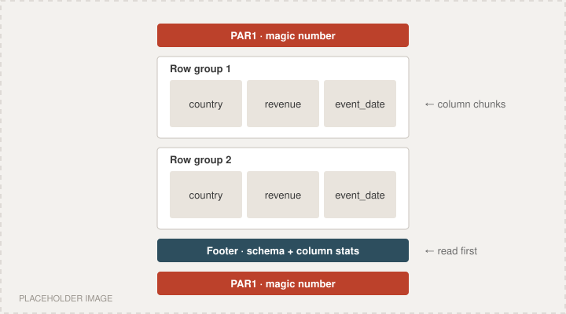

If you have touched a data lake, a Spark job, a pandas notebook or a DuckDB query in the last decade, you have almost certainly read a Parquet file. It is so ubiquitous that it has become invisible — the default answer to "how should we store this table?" But Parquet did not arrive fully formed. It came out of a very specific moment in the Hadoop era, borrowed its best idea from Google, and won mostly by being boringly reliable while everything around it changed.

## The problem: Hadoop stored data like a log file

In the late 2000s, Hadoop made it cheap to store enormous amounts of data on commodity machines. But the early file formats were row-oriented. Plain text and CSV, Hadoop `SequenceFile`s, and later Apache Avro all wrote one complete record after another.

Row-oriented storage is great for writing and for reading whole records. It is terrible for analytics. A typical analytical query looks like:

```sql
SELECT country, SUM(revenue)
FROM events
WHERE event_date >= '2013-01-01'
GROUP BY country;
```

That query touches three columns. If each event has a hundred columns, a row-oriented format forces you to read and decode all hundred from disk just to throw ninety-seven away. At petabyte scale, that waste is the whole cost of the query.

Columnar databases — C-Store, MonetDB, Vertica — had already shown the fix: store each column contiguously. Then you read only the columns you need, and because values in one column look alike, they compress far better. The Hadoop world needed the same thing, but as an open *file format* rather than a closed database.

## The spark: Google's Dremel paper (2010)

In 2010 Google published *Dremel: Interactive Analysis of Web-Scale Datasets*. Dremel was Google's internal engine for running SQL-like queries over trillions of rows in seconds. Its storage layer solved a problem the classic columnar databases had mostly avoided: **nested data**.

Real-world records are not flat. A tweet has a list of hashtags, each user has a list of devices, each device has a list of sessions. Flattening that into a table either explodes the row count or loses structure. Dremel's answer was the *record shredding and assembly* algorithm: split nested records into flat columns, and attach two small integers to every value —

- a **repetition level**, saying at which level of nesting a new list item starts, and
- a **definition level**, saying how many optional fields along the path are actually present (which is how nulls are encoded).

With just those two numbers, you can store any nested schema column by column and reconstruct the original records exactly. This is the heart of Parquet to this day.

## The birth: Twitter + Cloudera (2013)

Around 2012, engineers at Twitter (led by Julien Le Dem) and at Cloudera (led by Nong Li, working on the Impala query engine) were independently circling the same need: a columnar format for Hadoop that handled nested data well. They joined forces.

In March 2013, Twitter publicly announced **Parquet**, and version 1.0 followed that summer. The name is a nod to parquet flooring — strips of wood (columns) laid side by side to form a surface (a table).

A few design decisions made it stand out from day one:

- **Language and engine neutral.** The file metadata is defined with Apache Thrift, so any language can read it. Parquet did not belong to Hive, Pig, Impala or MapReduce — it worked with all of them.
- **Nested data as a first-class citizen**, via the Dremel encoding.
- **Self-describing files.** Every file carries its own schema and statistics.
- **Pluggable encodings and compression**, chosen per column.

The same year, Hortonworks and Facebook released **ORC** (Optimized Row Columnar) for Hive, which grew out of Facebook's earlier RCFile. ORC and Parquet would compete for years. ORC was arguably faster inside Hive; Parquet won the broader ecosystem.

Parquet entered the Apache Incubator in 2014 and graduated as a top-level Apache project in April 2015.

## What is actually inside a Parquet file

The layout has barely changed since 2013, which is part of why it is trusted:

```
PAR1                       <- 4-byte magic number
  Row group 1
    Column chunk: country    -> pages
    Column chunk: revenue    -> pages
    Column chunk: event_date -> pages
  Row group 2
    ...
Footer (FileMetaData: schema, row groups, column stats)
footer length
PAR1                       <- magic number again
```



- **Row groups** horizontally partition the data (often tens to hundreds of MB each), so large files can be processed in parallel.
- **Column chunks** hold one column's values within a row group.
- **Pages** are the smallest unit of encoding and compression.
- The **footer** lives at the *end* of the file. That lets a writer stream data out and only write the index when it is finished. Readers jump to the end, read the footer, and then fetch exactly the bytes they need.

The footer also stores min/max statistics per column chunk. A reader evaluating `event_date >= '2013-01-01'` can skip entire row groups whose maximum date is earlier, without decompressing anything. This is called *predicate pushdown*, and it is a huge part of Parquet's speed.

Inside the pages, encodings do much of the compression before a general-purpose codec ever runs:

- **Dictionary encoding** replaces repeated strings like `"India"` with small integers.
- **Run-length / bit-packing hybrid** encoding collapses repeated values and packs small integers tightly.
- **Delta encodings** store differences between sorted values such as timestamps.

Then a codec — originally Snappy and gzip, later Zstandard, LZ4 and Brotli — squeezes the result further. Compression ratios of 5–10x over raw CSV are common.

## The Spark years: from option to default (2014–2016)

Parquet's real breakout came with Apache Spark. When Spark SQL arrived, it made Parquet its default data source. Suddenly every `df.write.save(...)` produced Parquet unless you asked otherwise. Presto (later Trino), Drill, Hive and Impala all read it natively, and cloud warehouses began to import and export it.

A pattern emerged that we now take for granted: **data lakes on object storage** — S3, GCS, Azure Blob — full of Parquet files, queried in place by whatever engine you prefer. Parquet became the lingua franca that let storage and compute be decoupled.

## Arrow and the Python world (2016 onward)

In 2016, Apache Arrow launched as an *in-memory* columnar standard, co-created by Wes McKinney (the creator of pandas) and others. Arrow and Parquet are complementary: Parquet is how columns are stored on disk; Arrow is how they are laid out in memory. Converting between the two is cheap because both are columnar.

The C++ Parquet implementation moved into the Arrow project, and `pyarrow` made Parquet a first-class citizen in Python. A one-liner became the norm:

```python
import pandas as pd

df = pd.read_parquet("events.parquet", columns=["country", "revenue"])
```

Later engines built on this foundation — DuckDB, Polars, DataFusion — treat Parquet not as an import format but as a native table they can query directly.

## Growing up: indexes and bloom filters

The format kept evolving, carefully and backward-compatibly:

- **Page indexes** (column index and offset index) let readers skip individual pages, not just whole row groups.
- **Bloom filters** let readers quickly rule out row groups for equality lookups on high-cardinality columns such as IDs.
- **Logical types** were expanded to cover timestamps with explicit units, decimals, UUIDs and more.

## Table formats: Parquet becomes the bricks, not the building

By the late 2010s, the weaknesses of "a folder full of Parquet files" were obvious. There were no atomic commits, no safe concurrent writers, no cheap schema evolution, and listing millions of files on S3 was slow.

The answer was not to replace Parquet but to put a metadata layer on top of it:

- **Apache Hudi** (from Uber),
- **Apache Iceberg** (from Netflix), and
- **Delta Lake** (from Databricks).

All three add transaction logs, snapshots and schema evolution, and all three store their actual data in Parquet by default. This is the *lakehouse* architecture: warehouse-like guarantees on top of open files in object storage. Parquet went from being *the table* to being *the bricks the table is built from*.

## Where Parquet stands today

More than a decade on, Parquet faces real challengers. Formats such as Lance, Meta's Nimble and Vortex target workloads Parquet was not designed for: random access for ML training, very wide tables with thousands of columns, and fast decoding on modern hardware. The Parquet community has responded with active discussion about modernizing the format.

But Parquet's moat is not raw speed. It is that *everything* reads it — every engine, every cloud, every language. A format that every tool already speaks is extremely hard to displace.

## The takeaways

1. **Columnar wins for analytics.** Read only what you need, and compress similar values together.
2. **Nested data does not have to be flattened.** Dremel's repetition and definition levels were the key insight Parquet inherited.
3. **Open and neutral beats tightly integrated.** Parquet won because it belonged to no single engine.
4. **Layering beats replacing.** Iceberg, Delta and Hudi made Parquet more valuable, not obsolete.

The next time you call `read_parquet`, remember you are using an idea from a 2010 Google paper, packaged by two companies in 2013, that quietly became the foundation of the modern data stack.

*— Jay Modi*
